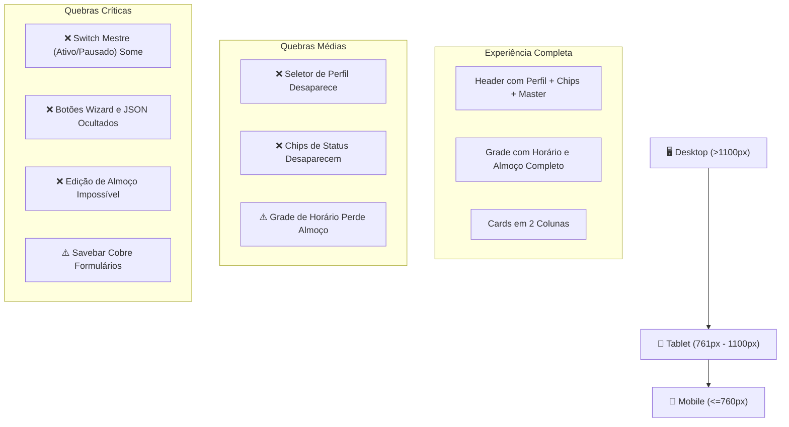
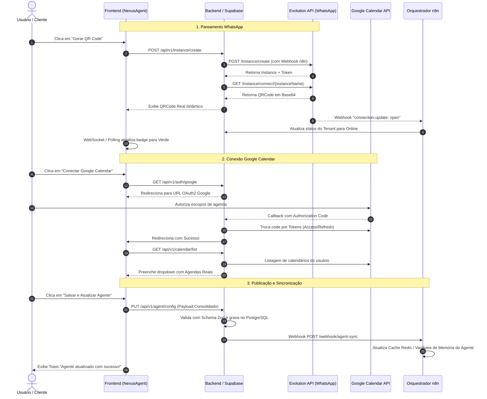
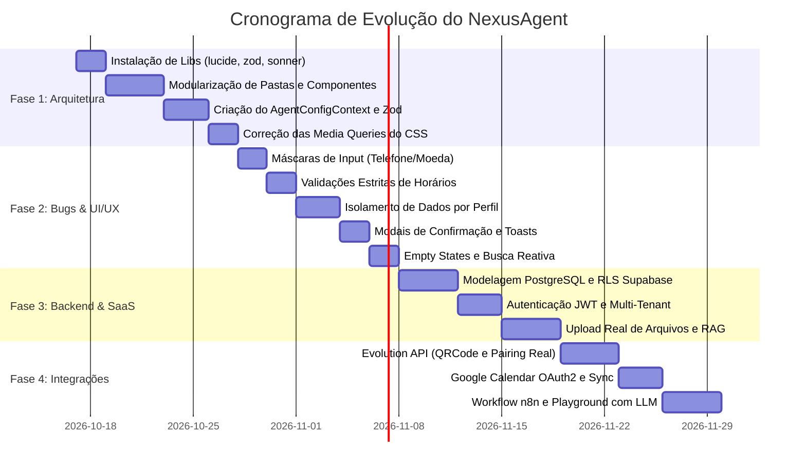

# 📋 RELATÓRIO DE AUDITORIA TÉCNICA, ARQUITETURAL E UI/UX
**Projeto:** NexusAgent / NexusAgent — Microssistema SaaS de Configuração e Personalização de Agente IA  
**Stack Principal:** React 19, TypeScript 5.7, Tailwind CSS v4, Vite 8 (Figma Make scaffold)  
**Integrações Alvo:** n8n (Orquestrador/Workflow), Evolution API (WhatsApp), Google Calendar (Agenda) e Supabase (Auth/DB/RAG)  
**Data da Auditoria:** 16 de Outubro de 2026  
**Auditor Responsável:** Arquiteto de Software Sênior, Engenheiro QA e Especialista em UI/UX  
**Status do Projeto:** Protótipo Funcional Monolítico (Necessita de Refatoração Estrutural e Camada de Serviços para Produção)

---

## 📑 ÍNDICE EXECUTIVO
1. [Arquitetura de Código e Qualidade Técnica](#1-arquitetura-de-código-e-qualidade-técnica)
2. [Auditoria de Front-end, Estado e Reatividade](#2-auditoria-de-front-end-estado-e-reatividade)
3. [Auditoria Funcional Aba por Aba (Checklist de Escopo)](#3-auditoria-funcional-aba-por-aba-checklist-de-escopo)
4. [Auditoria de UI/UX, Design System e Responsividade](#4-auditoria-de-uiux-design-system-e-responsividade)
5. [Prontidão para Back-end e Integração (n8n / Evolution / Google / DB)](#5-prontidão-para-back-end-e-integração-n8n--evolution--google--db)
6. [Mapeamento de Bugs, Edge Cases e Falhas de Validação](#6-mapeamento-de-bugs-edge-cases-e-falhas-de-validação)
7. [Plano de Ação (Roadmap Passo a Passo para Produção)](#7-plano-de-ação-roadmap-passo-a-passo-para-produção)

---

## 1. ARQUITETURA DE CÓDIGO E QUALIDADE TÉCNICA

### 1.1 Diagnóstico da Estrutura Atual
O projeto encontra-se atualmente estruturado em um formato **monolítico de arquivo único**:
- `src/App.tsx` (417 linhas): Condensa em um único arquivo todos os tipos, constantes globais, funções utilitárias, componentes atômicos (Button, Input, Select, Switch, Card, etc.), as cinco telas de abas completas (`Connections`, `Contacts`, `Schedule`, `Identity`, `Knowledge`), três modais complexos (`Modal`, `Wizard`), um Drawer lateral com chat (`ChatDrawer`), controle de estado local, lógica de sincronização com o `localStorage` e a simulação das respostas de IA.
- `src/index.css` (267 linhas): Centraliza todos os estilos globais, animações, layouts de grade, classes utilitárias personalizadas e media queries.
- **Impacto Arquitetural Negativo:**
  1. *Violação do Princípio da Responsabilidade Única (SRP - SOLID):* Uma única alteração visual na aba de Conexões exige a edição do mesmo arquivo que lida com as regras de agendamento ou com a simulação do chat.
  2. *Renderizações Desnecessárias (Performance):* Qualquer atualização no estado principal `config` reavalia toda a árvore de componentes montada dentro de `App.tsx`.
  3. *Conflitos de Merge:* Impossibilita o trabalho simultâneo de múltiplos desenvolvedores em abas ou recursos diferentes.
  4. *Baixa Testabilidade:* Não é possível criar testes unitários isolados para os componentes de UI ou hooks de lógica sem instanciar a aplicação inteira.

### 1.2 Auditoria de Tipagem TypeScript
A tipagem atual é rudimentar e apresenta brechas substanciais:
- **Inferência Insegura via `typeof initialConfig`:** O tipo principal `Config` não possui uma interface formal. É inferido de `initialConfig` (linha 94: `type Config = typeof initialConfig`). Qualquer alteração inadvertida nos valores padrão altera a assinatura do tipo em toda a aplicação.
- **Asserções de Tipo Forçadas (`as`) e Falhas de União:**
  - Na linha 294: `config.overflow[key as keyof typeof config.overflow] as boolean`. O objeto `overflow` contém `phone: string`. Esse type assertion forçado mascara o fato de que a propriedade `phone` pode ser tratada acidentalmente como booleana se a lista de chaves não for estritamente controlada.
  - Na linha 356: `config[key as keyof Config] as boolean` força um booleano genérico na iteração dos switches de WhatsApp (`splitMessages`, `typing`, `audio`, `images`).
  - No modal (linha 394): `Modal({ type: string, ... })` foi tipado como `string` genérica em vez de uma união estrita `"qr" | "calendar" | "json" | "wizard"`.
  - No ícone (linha 96): `Icon({ name: string })` permite qualquer string arbitrária. Nomes inválidos renderizam silenciosamente um SVG vazio.
- **Geração Insegura de Identificadores:**
  - A função `uid()` na linha 6 utiliza `Math.random().toString(36).slice(2, 9)`. Em listas com grande volume de dados ou concorrência, o risco de colisões de chaves de identificação é alto. Deve-se migrar para `crypto.randomUUID()`.

### 1.3 Plano de Modularização Proposto
O arquivo monolítico `src/App.tsx` deve ser fragmentado na seguinte árvore limpa e desacoplada:

```
src/
├── assets/                       # Ícones SVG e identidades visuais
├── types/                        # Interfaces e tipos estritos do domínio
│   ├── config.ts                 # AgentConfig, ProfileType, OverflowConfig
│   ├── schedule.ts               # DaySchedule, Holiday, TimezoneConfig
│   ├── knowledge.ts              # BusinessContext, CatalogItem, FaqItem, RagDocument
│   └── chat.ts                   # ChatMessage, SimulationContext
├── constants/                    # Valores imutáveis e configurações padrão
│   ├── initialConfig.ts          # Estado padrão do agente
│   ├── profileTemplates.ts       # Mapeamento dinâmico de rótulos por perfil
│   └── promptTemplates.ts        # Roteiros prontos para injeção rápida
├── components/
│   ├── ui/                       # Design System Apple Monochrome
│   │   ├── Button.tsx
│   │   ├── Input.tsx
│   │   ├── Select.tsx
│   │   ├── Textarea.tsx
│   │   ├── Switch.tsx
│   │   ├── SegmentedControl.tsx
│   │   ├── Checkbox.tsx
│   │   ├── Card.tsx
│   │   ├── Badge.tsx
│   │   ├── Field.tsx
│   │   ├── SettingRow.tsx
│   │   ├── Slider.tsx
│   │   └── Toast.tsx
│   ├── layout/                   # Estruturas de casca e navegação
│   │   ├── Header.tsx            # TopBar, Brand, StatusChips, MasterToggle
│   │   ├── TabNavigation.tsx     # Barra de abas com efeito blur
│   │   ├── PageTitle.tsx         # Títulos dinâmicos com indicador de progresso
│   │   └── FloatingSaveBar.tsx   # Barra flutuante de detecção de alterações
│   ├── tabs/                     # Telas isoladas por domínio
│   │   ├── TabConnections.tsx    # WhatsApp (Evolution) e Google Calendar
│   │   ├── TabContacts.tsx       # Filtros, Pausa Humana e Transbordo
│   │   ├── TabSchedule.tsx       # Grade Semanal, Feriados e Agendamento
│   │   ├── TabIdentity.tsx       # Tom de Voz, Prompt, Guardrails e Humanização
│   │   └── TabKnowledge.tsx      # Perfil Dinâmico, Catálogo, FAQ e RAG
│   ├── modals/                   # Diálogos modais especializados
│   │   ├── ConnectWhatsAppModal.tsx
│   │   ├── ConnectCalendarModal.tsx
│   │   ├── JsonPayloadModal.tsx
│   │   └── OnboardingWizardModal.tsx
│   └── drawer/                   # Gaveta de simulação
│       └── PlaygroundDrawer.tsx  # Simulador interativo do agente
├── context/                      # Provedores de estado reativo
│   └── AgentConfigContext.tsx    # Contexto global com dirty state e persistência
├── hooks/                        # Hooks customizados de lógica de negócio
│   ├── useAgentConfig.ts         # Hook de acesso ao contexto
│   ├── useDirtyDetection.ts      # Deep-diff entre rascunho e versão salva
│   └── usePlaygroundChat.ts      # Lógica de simulação de conversa
├── services/                     # Integração com APIs externas
│   ├── evolutionService.ts       # Endpoints da Evolution API v2
│   ├── googleCalendarService.ts  # OAuth2 e sincronização de eventos
│   ├── ragService.ts             # Upload e vetorização de documentos
│   └── n8nWebhookService.ts      # Despacho do payload consolidado
├── utils/                        # Formatadores e validadores
│   ├── masks.ts                  # Máscaras de telefone, moeda e horários
│   ├── validators.ts             # Schemas Zod de integridade de dados
│   └── uuid.ts                   # Gerador de identificadores seguros
├── App.tsx                       # Orquestrador raiz limpo e enxuto (~60 linhas)
└── main.tsx
```

### 1.4 Dependências e Build (`package.json`)
A análise do arquivo `package.json` revela uma base excessivamente reduzida herdada do scaffold Figma Make (`"name": "figma-make-app"`):
- **Bibliotecas Ausentes Críticas para Produção:**
  1. `lucide-react`: Atualmente, o código desenha 15 SVGs diretamente no código fonte dentro de um dicionário na linha 97. O uso do Lucide trará padronização visual, consistência de traço e suporte a centenas de ícones sem poluir arquivos de lógica.
  2. `zod`: Imprescindível para validar os dados persistidos no `localStorage` e a estrutura do payload antes do envio ao n8n.
  3. `sonner`: Necessário para fornecer notificações do tipo Toast no estilo iOS/macOS (ex: "Configurações sincronizadas com sucesso", "Payload copiado", "Arquivo removido").
  4. `clsx` e `tailwind-merge`: Essenciais para a composição limpa e dinâmica de classes Tailwind sem conflitos de especificidade.
  5. `date-fns` ou `dayjs`: Necessários para manipular horários comerciais, calcular buffers e formatar datas sem bugs de fuso horário.
  6. `axios`: Para padronizar interceptors, tratamento de erros e retentativas nas requisições HTTP para a Evolution API e back-end.

---

## 2. AUDITORIA DE FRONT-END, ESTADO E REATIVIDADE

### 2.1 Persistência e Tratamento de Dados no `localStorage`
- **Implementação Atual (Linhas 159-161):**
  ```typescript
  const [config, setConfig] = useState<Config>(() => {
    try { 
      return { ...initialConfig, ...JSON.parse(localStorage.getItem("NexusAgent-config") || "{}") }; 
    } catch { 
      return initialConfig; 
    }
  });
  ```
- **Vulnerabilidades Detectadas:**
  1. *Shallow Merge Destrutivo:* O operador spread `{ ...initialConfig, ...parsed }` realiza apenas mesclagem superficial (primeiro nível). Se o objeto salvo no `localStorage` possuir uma estrutura antiga de `business` ou `overflow` com campos ausentes, o objeto salvo sobrescreverá completamente os valores padrão dos campos aninhados, resultando em propriedades `undefined` em tempo de execução.
  2. *Inexistência de Migração de Versão:* O payload não armazena número de schema ou versão (ex: `version: "1.2.0"`). Qualquer refatoração estrutural que adicione novas propriedades ao agente quebrará o estado de usuários que possuam dados em cache.
  3. *Ausência de Fallback Granular:* Se o JSON for sintaticamente válido, mas contiver tipos incompatíveis (ex: um número no lugar de um array), o `try/catch` não intercepta o problema e a aplicação quebra na renderização.

### 2.2 Detecção de Alterações (Dirty State) e Barra Flutuante
- **Implementação Atual (Linha 172):**
  ```typescript
  const dirty = JSON.stringify(config) !== saved;
  ```
- **Avaliação Técnica:**
  - *Comportamento Geral:* A comparação por `JSON.stringify` funciona adequadamente para alterações simples e listas aninhadas enquanto as chaves mantiverem a mesma ordem de inserção.
  - *Botão "Descartar":* Executa `setConfig(JSON.parse(saved))` (linha 185). Restaura o rascunho com sucesso para o último estado consolidado.
  - *Botão "Salvar e Atualizar Agente":* Executa um `setTimeout(450)` simulando latência e grava no `localStorage`.
  - *Falhas Identificadas:*
    1. A barra flutuante é puramente local. Ela não notifica nenhum webhook nem banco de dados.
    2. Estados locais de rascunhos de itens (ex: o campo de adicionar novo contato na linha 272, nova data bloqueada na linha 302, nova regra na linha 331 e nova pergunta no FAQ na linha 369) **NÃO são resetados** quando o usuário clica em "Descartar", mantendo dados parciais nos campos de entrada.
    3. Não existe confirmação de sucesso visual após o salvamento; a barra apenas desaparece abruptamente.

### 2.3 Adaptação Dinâmica por Perfil (Empresa vs Profissional vs Pessoal)
A alternância do seletor superior afeta:
1. Os rótulos do cabeçalho da página na Aba 5 (através do dicionário `profileLabels`).
2. O subtítulo do card de Fuso Horário e o título da Grade Semanal na Aba 3.
3. A renderização condicional dos formulários da Aba 5 (linhas 374 a 376).
- **FALHA CRÍTICA DE SOBRESCRITA DE DADOS (Data Bleeding):**
  - Todas as três visões de perfil compartilham o **mesmo objeto de dados** `config.business`.
  - Exemplo real de falha: No perfil "Pessoal", o campo `Meu nome` altera `business.name`. Se o usuário alternar para o perfil "Empresa", o `Nome fantasia` da empresa terá sido sobrescrito pelo nome da pessoa!
  - No perfil "Profissional", o campo de pagamentos é preenchido como texto separado por vírgula (`e.target.value.split(",")`), enquanto no perfil "Empresa" ele é preenchido através de checkboxes selecionáveis (`PIX`, `Cartão`, `Boleto`, `Dinheiro`). Se o usuário editar as formas de pagamento no perfil Profissional e voltar para Empresa, a marcação dos checkboxes quebra devido a formatação de espaços (ex: `" Cartão"` em vez de `"Cartão"`).

### 2.4 Análise dos CRUDs Internos

| CRUD / Módulo | Criação | Edição | Exclusão | Status Técnico / Falhas |
| :--- | :---: | :---: | :---: | :--- |
| **1. Exceções (Blacklist / Whitelist)** | Sim | **Não** | Sim | Não permite editar contatos já criados; permite cadastrar contatos sem telefone. |
| **Contatos Recentes** | **Não** | Parcial | **Não** | Lista estática de 3 contatos mockados. O switch de ativação funciona, mas o campo de busca é inoperante. |
| **2. Feriados e Datas Bloqueadas** | Sim | **Não** | Sim | Não valida se a data já passou ou se é duplicada. Formatação por `split("-")` suscetível a erros. |
| **3. Catálogo de Produtos / Serviços** | Sim | Sim | Sim | Campos inline na tabela. Preço e duração sem máscaras ou validação de tipo. |
| **4. FAQ Rápido** | Sim | **Não** | Sim | Acordeão não permite alterar perguntas ou respostas existentes; obriga a deletar e recriar. |
| **5. Guardrails Personalizados** | Sim | **Não** | Sim | Adiciona texto e permite remoção. Não permite edição. |
| **6. Upload de Documentos (RAG)** | Sim | **Não** | Sim | **MOCK FALSO TOTAL:** Apenas extrai `f.name` e `f.size` no evento do `<input type="file">`. Não lê o conteúdo do arquivo nem gera embeddings. |

---

## 3. AUDITORIA FUNCIONAL ABA POR ABA (CHECKLIST DE ESCOPO)

### 3.1 Header & Navegação Global
- **Seletor de Perfil:** Funcional no desktop, mas **desaparece completamente** em telas abaixo de 1100px por regra CSS direta (`.topbar > .segmented { display: none; }`).
- **Badges Clicáveis de Status:** Possuem gatilho para abrir o modal de pareamento apenas se desconectados (`onClick={() => !config.whatsapp && setModal("qr")}`). Se a integração já estiver ativa, o clique é ignorado e não abre detalhes da instância.
- **Toggle Mestre (Agente Ativo/Pausado):** Reativo no desktop, porém **ocultado em dispositivos móveis** (`.master { display: none; }` abaixo de 760px). Um administrador usando celular não consegue pausar o agente em momentos de emergência.

### 3.2 Aba 1: Conexões (WhatsApp & Agenda)
- **WhatsApp (Evolution API):**
  - O botão "Gerar QR Code" abre o modal simulado.
  - O botão "Usar código de pareamento" (linha 261) é um **elemento inerte sem listener de clique** (`<Button variant="ghost">Usar código de pareamento</Button>`).
  - O QR Code exibido é um gradiente CSS estático com ícone central. O botão "Simular leitura com sucesso" apenas seta o booleano `whatsapp: true`.
- **Google Calendar:**
  - O modal de autorização simula um diálogo OAuth.
  - Quando conectado, o `<Select>` de "Agenda ativa" exibe opções fixas em código (*Agenda principal, Consultório, Reuniões*), sem carregar agendas reais da conta.

### 3.3 Aba 2: Atendimento, Contatos e Transbordo
- **Switches de Grupos e Stories:** Atualizam perfeitamente `ignoreGroups` e `ignoreStories`.
- **Modo de Operação:** Transição reativa entre "all", "blacklist" e "whitelist". A lista de exceções abre condicionalmente quando selecionada.
- **Pausa Humana & Intervenção:** O campo de horas aceita valores numéricos, mas não bloqueia números negativos. O campo de busca em "Contatos recentes" não possui `value` ou `onChange`, agindo como componente morto.
- **Transbordo Humano:** Checkboxes de gatilho e campo de telefone funcionais no estado, porém desprovidos de validação de formato E.164.

### 3.4 Aba 3: Horários, Feriados e Agenda
- **Fuso Horário:** Dropdown funcional com 4 cidades, mas não cobre a totalidade dos fusos brasileiros (ex: Fernando de Noronha, Acre, etc.).
- **Grade Semanal (Segunda a Domingo):**
  - Permite configurar abertura, fechamento e intervalo de almoço por dia da semana.
  - O botão "Replicar segunda até sexta" funciona corretamente aplicando as configurações do índice 0 aos índices de 1 a 4.
  - **FALHA GRAVE DE VALIDAÇÃO:** Permite definir horários de abertura posteriores ao fechamento (ex: Início 19:00 e Término 07:00 sem suporte a virada de turno), ou intervalos de almoço fora da jornada diária.
  - **FALHA GRAVE DE RESPONSIVIDADE:** Em telas abaixo de 760px, o controle do almoço é ocultado via CSS (`.day-row .lunch { display: none; }`), impedindo a edição em celulares.
- **Regras de Agendamento:** Inputs de antecedência mínima e janela máxima aceitam números negativos via teclado. A caixa de seleção de campos obrigatórios (`Nome completo`, `CPF`, `E-mail`, `Serviço`) é totalmente funcional.

### 3.5 Aba 4: Identidade, Comportamento e WhatsApp
- **Identidade:** Nome do agente, switches de apresentação e divulgação de IA respondem imediatamente.
- **Personalidade:** Botões do tipo "Pill" para tom de voz e slider de tamanho de resposta operam com fluidez.
- **Humanização no WhatsApp:** Slider de debounce (0 a 30s) e switches de comportamento operacionais no estado.
- **Prompt Livre e Templates:** O seletor de templates na linha 364 substitui corretamente o conteúdo da caixa de texto do prompt com cenários para Clínicas, Lojas, Barbearias, Escritórios e Uso Pessoal.

### 3.6 Aba 5: Contexto e Base de Conhecimento
- **Formulário de Negócio:** Reativo, com campos adequados às três personas, mas sofrendo da contaminação mútua de dados descrita na Seção 2.3.
- **Catálogo:** Tabela editável inline, porém com quebra visual em telas estreitas caso o usuário não perceba o scroll horizontal.
- **FAQ:** Lista do tipo acordeão com exclusão e adição operantes.
- **Documentos RAG:** Apenas cosmético; não lê arquivos nem cria base vetorial.

### 3.7 Modais e Gavetas
1. **Wizard de Onboarding (4 Passos):**
   - Transita com sucesso entre as etapas sem perder o estado global da aplicação.
   - Permite que o usuário conclua o fluxo sem preencher o nome do agente ou sem definir dados essenciais.
2. **Playground de Teste ("ChatDrawer"):**
   - **Mecanismo de Geração das Respostas (Linhas 191-195):**
     ```typescript
     const style = config.tone.toLowerCase();
     const reply = `Olá! Eu sou ${config.agentName}. Entendi sua mensagem sobre “${text.slice(0, 42)}${text.length > 42 ? "…" : ""}”. Vou ajudar de forma ${style} e objetiva. ${config.goal === "Agendamento" ? "Qual é o melhor dia e período para você?" : "Pode me contar um pouco mais?"}`;
     ```
   - **Diagnóstico Crítico:** Trata-se de uma interpolação de strings puramente mockada com atraso artificial de 700ms.
   - Não consulta LLM real.
   - Não consulta a base de conhecimento (ignora o catálogo de produtos e as regras de FAQ).
   - Ignora se o agente está ativo ou pausado (responde normalmente mesmo com `config.active === false`).
   - Ignora os guardrails e as instruções livres do prompt.
3. **Modal "Payload JSON":**
   - Exibe a totalidade do estado em formato JSON indentado.
   - O botão "Copiar JSON" transfere o texto via `navigator.clipboard`, mas não exibe confirmação visual de sucesso.

---

## 4. AUDITORIA DE UI/UX, DESIGN SYSTEM E RESPONSIVIDADE

### 4.1 Fidelidade Estética e Design System (Apple / iOS Monochrome)
- **Pontos Fortes:**
  - Aplicação primorosa dos tokens visuais da Apple: fundo `#f5f5f7`, cartões em branco puro (`#ffffff`) com sombras difusas multicamadas, bordas ultrafinas (`rgba(0, 0, 0, 0.08)`), destaques monocromáticos pretos (`#000000`) e toques precisos de verde `#34c759` e vermelho `#ff3b30`.
  - Excelente aplicação de controles segmentados (Segmented Controls) com cantos arredondados (12px), interruptores táteis com física visual idêntica ao iOS e efeito de desfoque de fundo (`backdrop-filter: blur(20px)`).
- **Inconsistências Identificadas:**
  - O arquivo `src/index.css` mistura seletores clássicos de CSS tradicional com a infraestrutura do Tailwind CSS v4.
  - Diversos componentes utilizam medidas fixas em pixels (`min-width: 310px`, `width: 190px`, `height: 38px`), o que gera rigidez desnecessária em layouts fluidos.

### 4.2 Responsividade e Quebras de Layout



- **Dispositivos Móveis (`<= 760px`):**
  1. *Ocultamento do Switch Mestre:* A classe `.master` é definida com `display: none;` na linha 246. Em smartphones, o usuário não tem como pausar ou reativar o agente pelo topo.
  2. *Supressão do Seletor de Perfil:* A classe `.topbar > .segmented` é ocultada a partir de 1100px, tornando impossível navegar entre perfis em iPads ou celulares.
  3. *Eliminação dos Intervalos de Almoço:* O seletor `.day-row .lunch { display: none; }` esconde o toggle e os horários de intervalo diário no mobile.
  4. *Barra Flutuante Bloqueante:* A `.savebar` passa a ocupar grande área vertical no rodapé (`flex-direction: column; align-items: stretch;`), cobrindo botões de ação e campos inferiores de formulário.

### 4.3 Experiência do Usuário (UX) e Feedbacks Visuais
- **Falta de Estados de Carregamento (Loading States):** Não há spinners visuais ao clicar em "Salvar e atualizar agente" ou ao adicionar novos itens às tabelas.
- **Ausência de Diálogos de Confirmação:** Ações de alto impacto, como desconectar o WhatsApp da empresa ou desvincular a agenda, ocorrem imediatamente com um único clique.
- **Inexistência de Estados Vazios Amigáveis (Empty States):** Se a tabela de catálogo ou a lista de exceções estiverem sem itens, a tela exibe apenas áreas em branco ou cabeçalhos desolados, sem um convite claro à ação.

---

## 5. PRONTIDÃO PARA BACK-END E INTEGRAÇÃO (N8N / EVOLUTION / GOOGLE / DB)

### 5.1 Análise do Payload JSON Consolidado (`agentConfig`)
O JSON gerado pelo sistema é rico, mas necessita de refinamento estrutural para que possa ser ingerido diretamente por nós de automação no n8n:
- **Tipagem Não Padronizada:**
  - `duration` é armazenado como string textual (`"30 min"`, `"45 min"`, `"Por serviço"`), enquanto `minNotice` é numérico (`2`) e no catálogo a duração é string de dígitos (`"50"`). O n8n terá de aplicar múltiplos nós de regex para normalizar os minutos.
  - `price` no catálogo salva textos como `"R$ 250"` ou `"Sob consulta"`. Para fins transacionais, deve ser desmembrado em `{ amount: 25000, currency: "BRL", formatted: "R$ 250,00" }`.
- **Propriedades Indispensáveis Faltantes no Payload:**
  - `tenantId` / `userId`: Identificação do cliente proprietário da configuração em ambiente multi-tenant.
  - `instance`: `{ instanceName: "nexus-empresa-123", apiKey: "...", status: "open", serverUrl: "https://..." }`.
  - `calendarIntegration`: `{ googleCalendarId: "primary", syncToken: "...", timezone: "America/Sao_Paulo" }`.
  - `updatedAt` / `version`: Timestamps e controle de versão do schema para auditoria.

### 5.2 Mapeamento de Pontos de Integração Real (Substituição de Mocks)



1. **Evolution API v2:**
   - Substituir o mock gráfico por chamadas aos endpoints `/instance/create`, `/instance/connect/{instance}` e `/instance/pairing-code/{instance}`.
   - Implementar polling ou conexão WebSocket para escutar o status `connection.update` e atualizar o badge da interface no momento exato em que o celular ler o código.
2. **Google Calendar API:**
   - Substituir o botão simulado pelo fluxo OAuth2 oficial (Authorization Code Flow) com escopos `calendar.events` e `calendar.readonly`.
   - Obter e persistir com segurança o `refresh_token` criptografado no banco de dados.
   - Chamar a rota `calendarList.list` para preencher o `<Select>` da Aba 1 com as agendas de verdade da conta conectada.
3. **Pipeline de RAG (Supabase Storage + pgvector):**
   - Substituir o mock do `<input type="file">` pelo envio multipart/form-data do arquivo para o bucket de armazenamento.
   - Disparar webhook para o n8n ou Edge Function para fragmentação do texto (chunking), vetorização e salvamento na tabela `document_embeddings`.
4. **Camada SaaS Multi-Tenant:**
   - Adicionar autenticação com JWT (JSON Web Tokens) e políticas de RLS (Row Level Security) no banco PostgreSQL para que cada cliente visualize e edite exclusivamente a sua própria instância de agente.

---

## 6. MAPEAMENTO DE BUGS, EDGE CASES E FALHAS DE VALIDAÇÃO

Abaixo estão listadas todas as falhas de código mapeadas linha a linha:

1. **Bug #01 — Contaminação Mútua de Dados entre Perfis (Data Bleeding):**
   - *Local:* Linhas 374 a 376 em `src/App.tsx`.
   - *Impacto:* Como `business` é um único objeto compartilhado, editar os dados em "Pessoal" sobrescreve as variáveis correspondentes de "Empresa" e corrompe o array de formas de pagamento.
2. **Bug #02 — Input de Busca de Contatos Inoperante:**
   - *Local:* Linha 290 em `src/App.tsx`.
   - *Impacto:* O campo `<Input placeholder="Buscar contato" />` é puramente estático. Não tem `value`, não tem `onChange` e não filtra a lista de contatos recentes.
3. **Bug #03 — Botão "Usar código de pareamento" Inerte:**
   - *Local:* Linha 261 em `src/App.tsx`.
   - *Impacto:* O botão não possui propriedade `onClick`. Usuários que não conseguem utilizar a câmera do celular ficam impedidos de parear o WhatsApp.
4. **Bug #04 — Permissão de Horários Invertidos e Inconsistentes:**
   - *Local:* Linha 307 em `src/App.tsx`.
   - *Impacto:* Os inputs aceitam qualquer combinação de horários. Um usuário pode definir que a empresa abre às 22:00 e fecha às 06:00, ou que o almoço ocorre às 14:00 em uma jornada que termina às 12:00.
5. **Bug #05 — Aceitação de Valores Numéricos Negativos:**
   - *Local:* Linhas 289, 323 e 379 em `src/App.tsx`.
   - *Impacto:* Os campos `reactivateHours`, `minNotice`, `maxFuture` e a duração de itens no catálogo aceitam números negativos (ex: `-5 dias`), o que gerará exceções matemáticas nos cálculos de agendamento do n8n.
6. **Bug #06 — Quebra Potencial de Renderização em Feriados (`Cannot read properties of undefined`):**
   - *Local:* Linha 313 em `src/App.tsx`.
   - *Impacto:* O componente renderiza a data usando `h.date.split("-")[2]`. Se o valor de `date` estiver corrompido ou mal formatado, a aplicação sofrerá um erro fatal de runtime.
7. **Bug #07 — Sumiço de Controles Críticos em Telas Móveis e Tablets:**
   - *Local:* Linhas 237, 238, 246 e 260 em `src/index.css`.
   - *Impacto:* Em resoluções abaixo de 1100px e 760px, o seletor de perfil, os chips de status, o toggle mestre de Ativar/Pausar e o controle de almoço desaparecem completamente da interface.
8. **Bug #08 — Ausência de Confirmação em Ações Destrutivas:**
   - *Local:* Linhas 261, 266, 284, 313, 361, 379, 383 e 388 em `src/App.tsx`.
   - *Impacto:* Desconectar integrações ou deletar itens de tabelas ocorre com um único clique acidental, sem modal de confirmação ou opção de desfazer.
9. **Bug #09 — Playground sem Inteligência e Desconectado do Estado Real:**
   - *Local:* Linhas 191 a 195 em `src/App.tsx`.
   - *Impacto:* Responde sempre o mesmo texto padrão engessado; ignora catálogo, FAQs, prompt customizado e responde até mesmo quando o agente está marcado como pausado.
10. **Bug #10 — Falta de Sanitização e Validação Zod no `localStorage`:**
    - *Local:* Linhas 159 a 161 em `src/App.tsx`.
    - *Impacto:* Dados obsoletos ou malformados persistem no navegador do usuário e impedem que novos campos entrem em vigor sem a limpeza manual dos cookies/storage.

---

## 7. PLANO DE AÇÃO (ROADMAP PASSO A PASSO PARA PRODUÇÃO)



### 🎯 FASE 1: Refatoração, Modularização e Arquitetura Limpa
1. **Atualização do `package.json`:**
   - Renomear o projeto para `"NexusAgent-app"`.
   - Adicionar dependências fundamentais: `lucide-react`, `zod`, `sonner`, `clsx`, `tailwind-merge` e `date-fns`.
2. **Decomposição do `src/App.tsx`:**
   - Criar os módulos da árvore proposta na Seção 1.3.
   - Extrair os átomos do Design System para `src/components/ui/`.
   - Mover cada aba para um arquivo dedicado em `src/components/tabs/`.
3. **Criação do Provedor de Estado (`AgentConfigContext.tsx`):**
   - Implementar validação e migração de schema com Zod no carregamento do `localStorage`.
   - Implementar deep comparison para o Dirty State com algoritmo determinístico.
4. **Correção das Folhas de Estilo (`src/index.css`):**
   - Remover as regras destrutivas que escondem o Seletor de Perfil, os Chips de Conexão, o Switch Mestre e o Almoço no mobile e tablet.
   - Ajustar o layout do TopBar para scroll horizontal sutil ou menu dropdown em telas menores que 760px.

### 🎯 FASE 2: Correção de Bugs, Validações e Polimento de UI/UX
1. **Camada de Validação e Máscaras:**
   - Aplicar máscaras automáticas nos campos de telefone (`+55 (XX) XXXXX-XXXX`), chave PIX e moedas (`R$ 0,00`).
   - Bloquear inserção de números negativos via validação `min={0}` e schema Zod.
   - Validar logicamente os horários: impedir início >= fim e garantir que a pausa de almoço esteja contida dentro do expediente.
2. **Separação Estrutural de Dados por Perfil:**
   - Reestruturar o estado para manter objetos isolados: `config.businessCompany`, `config.businessProfessional` e `config.businessPersonal`.
3. **Segurança de Ações e Notificações (UX):**
   - Integrar o componente `<Toaster />` do `sonner` com avisos de salvamento, cópia de JSON e erros de validação.
   - Criar o componente `<ConfirmModal />` para interceptar pedidos de desconexão e exclusão de itens de catálogo e FAQs.
4. **Polimento de Telas:**
   - Implementar o filtro reativo de busca na lista de contatos recentes.
   - Implementar suporte à edição direta (botão de lápis) para exceções de contatos, feriados e FAQs.
   - Criar Empty States explicativos com ilustrações ou ícones sutis.

### 🎯 FASE 3: Camada de Serviços, Autenticação e Banco de Dados (SaaS)
1. **Configuração do Supabase / PostgreSQL:**
   - Criar tabelas com isolamento multi-tenant: `tenants`, `agent_configs`, `catalog_items`, `faq_items`, `document_embeddings`.
   - Configurar Row Level Security (RLS) baseado no `auth.uid()`.
2. **Autenticação e Gestão de Assinaturas:**
   - Telas de Login, Cadastro e Recuperação de Senha.
   - Injeção do `tenant_id` em todas as transações e payloads.
3. **Serviço Real de RAG:**
   - Upload de arquivos PDF/DOCX para o Supabase Storage.
   - Edge Function para extração de texto e geração de embeddings com modelo `text-embedding-004`.

### 🎯 FASE 4: Integrações com n8n, Evolution API e Google Calendar
1. **Integração Real com Evolution API:**
   - Conectar o botão "Gerar QR Code" ao endpoint da Evolution API, exibindo o QR Code real em tela com reconexão automática.
   - Ativar o botão "Usar código de pareamento" abrindo modal com input de número e exibição dos 8 dígitos gerados pela Evolution.
   - Webhooks no n8n para atualizar o status do badge em tempo real.
2. **Integração Real com Google Calendar:**
   - Fluxo completo de autorização OAuth2 do Google.
   - Dropdown da Aba 1 preenchido com a lista real de calendários da conta do usuário.
3. **Conexão do Playground com LLM:**
   - Integrar o Drawer lateral a uma rota de API com Gemini ou OpenAI para simular o comportamento real do agente, validando respostas com base no catálogo, horários e guardrails configurados antes da ativação do WhatsApp.
4. **Disparo Consolidado para o n8n:**
   - Envio do payload via webhook autenticado para o n8n na ação de "Salvar e Atualizar Agente", sincronizando os nós de roteamento do fluxo de atendimento.

---
*Relatório finalizado e validado para a equipe de engenharia e produto.*

